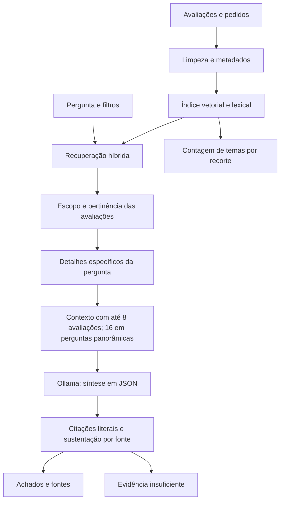

# Tech Challenge — Fase 4

## Voice of Customer Intelligence com RAG

Aplicação para investigar avaliações históricas do e-commerce da Olist. Logística, atendimento e produto podem recuperar relatos por pergunta, abrir os comentários que sustentam cada achado e consultar a frequência de temas explícitos no recorte escolhido.

A Fase 1 tratou satisfação como problema preditivo. Aqui, a nota é um filtro para investigar o que o cliente escreveu. Das fases 2 e 3, o projeto retoma a documentação do fluxo de dados, a execução reproduzível e o reporte das métricas com suas limitações.

## Executar no Windows

Requer Python 3.10 ou superior e, para gerar respostas em linguagem natural, [Ollama](https://ollama.com/download). Os comandos devem ser executados na raiz do projeto. A interface abre em [localhost:5050](http://127.0.0.1:5050).

```powershell
python -m venv .venv
.\.venv\Scripts\python.exe -m pip install -r requirements-e5.txt
Copy-Item .env.example .env
ollama pull gemma3:4b
```

Abra o Ollama. Se o aplicativo estiver fechado e o serviço ainda não estiver rodando, execute `ollama serve` em outro terminal. O modelo e o endereço são configuráveis em `.env`. Em Linux ou macOS, use `.venv/bin/python` e `cp .env.example .env`.

### Base oficial da Olist

Baixe o ZIP do [Brazilian E-Commerce Public Dataset by Olist](https://www.kaggle.com/datasets/olistbr/brazilian-ecommerce). O importador extrai somente avaliações e pedidos. Também é possível colocar os dois CSVs diretamente em `data/raw/`. A primeira indexação E5 baixa os pesos do modelo e pode demorar em CPU.

```powershell
.\.venv\Scripts\python.exe -m scripts.import_olist "C:\caminho\archive.zip"
.\.venv\Scripts\python.exe -m voc.index --source data/raw --target data/index/olist --backend e5
.\.venv\Scripts\python.exe -m voc.app --index data/index/olist
```

O índice é persistido. Nas execuções seguintes, basta iniciar o Ollama e repetir o último comando. Para uma indexação sem download de pesos, use `--backend lsa`. LSA usa projeção de TF-IDF treinada no próprio corpus.

### Demonstração reproduzível

O corpus sintético, identificado no painel, permite conferir a interface, busca, filtros e frequência sem baixar dados nem pesos de embedding. Para este modo, basta instalar `requirements.txt`. As respostas geradas ainda dependem do Ollama. Quando ele estiver indisponível, a interface mostra as avaliações recuperadas e a aba Frequência segue disponível.

```powershell
.\.venv\Scripts\python.exe -m scripts.make_demo
.\.venv\Scripts\python.exe -m voc.index --source data/demo --target data/index/demo --backend lsa --demo
.\.venv\Scripts\python.exe -m voc.app --index data/index/demo
```

## Arquitetura



| Componente | Implementação | Decisão |
| --- | --- | --- |
| Preparação | CSV e biblioteca padrão Python | Preserva a unidade de evidência e permite rastrear o CSV original. |
| Embedding | Multilingual E5 Small, PyTorch e Transformers | Vetores de consultas e comentários no mesmo espaço, com suporte a português. |
| Recuperação lexical | TF-IDF de unigramas e bigramas, scikit-learn | Ajuda a recuperar termos específicos e complementa o vetor denso. |
| Índice vetorial | NumPy, busca exata por cosseno, persistência NPZ/JSON | A escala do desafio permite começar com uma solução local e inspecionável. |
| Geração | Ollama e Gemma 3 4B por padrão | Mantém a inferência local e aceita a troca de modelo por configuração. |
| Interface | Flask, HTML, CSS e JavaScript | Permite executar a demonstração pelo navegador com filtros e fontes expansíveis. |

### Preparação da base

1. Ler a tabela de avaliações e enriquecer por `order_id` com as datas da tabela de pedidos. Ano corresponde ao ano da compra. Atraso corresponde a dias corridos entre data efetiva e estimada. Datas ausentes ficam nulas e saem do recorte de entregas atrasadas.
2. Validar identificadores e notas de 1 a 5. Concatenar título e comentário quando disponíveis, normalizar espaços e Unicode e mascarar padrões de e-mail e telefone. A máscara tem cobertura parcial, pois nomes e formatos diferentes podem permanecer no texto.
3. Remover linhas sem texto útil e avaliações duplicadas por pedido, nota e texto normalizado. Um documento representa uma avaliação. O agrupamento por pedido é usado na contagem e na diversificação dos resultados. O manifesto registra contagens e SHA-256 dos arquivos.
4. Codificar documentos com o prefixo `passage:` e consultas com `query:` no E5. O pooling considera a máscara de atenção e os vetores são normalizados. No LSA, a consulta é projetada na mesma base SVD dos documentos.

### Busca, geração e rastreabilidade

1. Aplicar filtros antes do ranqueamento. Calcular duas listas por similaridade, lexical e vetorial. Usar limiares mínimos e combinar as posições por Reciprocal Rank Fusion. Diversificar o contexto por pedido e por texto.
2. Uma triagem prévia com o modelo descarta perguntas fora do escopo e avaliações sem relação com o tema. Um filtro adicional exige que detalhes específicos citados na pergunta, como duração de uma garantia ou meio de entrega, apareçam na mesma avaliação. Em seguida, enviar a pergunta e as avaliações restantes (até oito nas perguntas comuns, 16 nas panorâmicas) ao modelo. Cada avaliação fornece até 1.500 caracteres. O prompt restringe o modelo aos relatos recuperados e instrui a ignorar comandos dentro deles.
3. Perguntas panorâmicas ("principais", "mais elogiados", "padrões") recuperam 16 avaliações e o modelo é avisado de que é uma amostra. Pedidos de contagem ("quantos", "frequência") são direcionados à aba Frequência. O limiar vetorial do E5 pode ser ajustado em `E5_MIN_SCORE` no `.env` e deve ser calibrado com a base real.
4. Aceitar até três achados, cada um com uma a três fontes. Conferir se cada ID veio do contexto e localizar cada citação no texto enviado, tolerando diferenças de maiúsculas, acentos e pontuação. A citação exibida é extraída do comentário original. O painel mostra o texto preparado, a nota e os identificadores originais da avaliação e do pedido.
5. Exibir uma mensagem de evidência insuficiente se a busca voltar vazia ou a resposta não trouxer citações válidas. Uma citação literal comprova a origem do trecho. Uma verificação adicional, feita pelo modelo **citação por citação**, remove as fontes que não sustentam o achado; um achado sem fontes é descartado. Ela reduz o problema, mas não o elimina: a conferência humana continua necessária.

### Frequência de temas

Pedidos com pelo menos uma avaliação textual no recorte formam o denominador. Cada pedido conta uma vez por tema explícito, identificado por expressões regulares (14 temas, de atraso e pedido não recebido a embalagem, troca e recomendação). No grupo **Todos**, o painel também lista até cinco expressões de duas palavras que se destacam no recorte em relação ao corpus inteiro (descoberta automática, sem dicionário), o que revela assuntos fora dos temas cadastrados, como "nota fiscal". Elas não são classificadas como elogio ou reclamação, por isso não aparecem nos outros grupos. Para essas expressões, o denominador é o número de **avaliações**, e o trecho exibido contém as duas palavras adjacentes no comentário; acentos são ignorados na contagem. Expressões precedidas de negação ("sem defeito", "não houve atraso") são ignoradas **nos temas cadastrados**; a descoberta automática não interpreta negações. Um pedido pode aparecer em vários temas. Menções implícitas, variantes fora do dicionário e ambiguidades podem afetar o resultado. As fontes exibidas são exemplos.

## Perguntas e resultados esperados

| Pergunta | Como demonstrar | Evidência esperada |
| --- | --- | --- |
| Quais avaliações mencionam que o pedido não chegou? | Investigar, notas 1 e 2 | Comentários explicitando não recebimento. Na demo, os pedidos rotulados são D05 e D06. |
| O que os clientes elogiam sobre a qualidade dos produtos? | Investigar, notas 4 e 5 | Relatos que mencionam a qualidade do material, tecido ou acabamento. |
| Quais temas aparecem nas reclamações sobre entregas atrasadas? | Frequência, Reclamações, notas 1 e 2 e filtro de atraso | Contagem de pedidos por tema e exemplos de avaliações vinculadas aos pedidos do recorte. |
| Quais avaliações mencionam a garantia estendida de cinco anos para celulares? | Investigar, todas as notas | Evidência insuficiente: avaliações de outras garantias não comprovam a duração e o produto pedidos. |
| Qual era a margem de lucro da Olist? | Investigar, todas as notas | Resposta esperada de evidência insuficiente. A recuperação pode encontrar textos apenas parecidos. |

**Exemplo executado no modo Frequência, com dados sintéticos.** Com notas 1 e 2 e o filtro de entregas atrasadas, o painel reportou “Atraso mencionado: 5 de 6 pedidos com avaliação textual”. Uma das fontes é o pedido sintético D22, cujo comentário menciona que “o pacote chegou depois do prazo”.

### Exemplos reais (base oficial da Olist, E5 + Gemma 3 4B)

Saídas completas, com texto e IDs de todas as evidências, em `reports/exemplos_olist.json`. A saída do modelo pode variar um pouco entre execuções.

**Quais avaliações sustentam a conclusão de que há problemas de prazo de entrega?** (notas 1 e 2)

- O status do transporte não forneceu justificativas para atrasos e falta de contato. Fonte: “ao longo do período, pedi mais detalhes do status para acompanhar o processo e nunca ligaram.” (nota 1, pedido `a3b14686…`).
- O recebimento do produto foi finalizado sem a entrega. Fonte: “O prazo de entrega finalizou e nao recebi o produto” (nota 1, pedido `debba1cc…`).

**Quais avaliações mencionam que o pedido não chegou?** (notas 1 e 2)

- O pedido não foi entregue. Fonte: “O pedido não foi entregue” (nota 1, pedido `2474b506…`).
- Meu pedido não foi entregue. Fonte: “o pedido nao foi entregue” (nota 1, pedido `975f731e…`).

**O que os clientes elogiam sobre a qualidade dos produtos?** (notas 4 e 5)

- Os clientes mencionam que os produtos são de qualidade. Fonte: “produtos de qualidade” (nota 5, pedido `714e2644…`).
- Alguns clientes relatam que a qualidade dos produtos é excelente. Fonte: “qualidade e agilidade” (nota 4, pedido `22e4add7…`).

**Quais são os principais problemas relatados pelos clientes?** (notas 1 e 2)

- Clientes relatam atrasos na entrega e falta de comunicação. Fonte: “Produto mais que passou do prazo de entregar, tento resolver o problema com a empresa e não consigo falar com ” (nota 1, pedido `1e189a60…`).
- Clientes recebem produtos errados ou incompletos. Fonte: “Oque aconteceu com o meu pedido ? Me mandaram uma peça totalmente diferente da qual eu comprei” (nota 1, pedido `f5fd5a60…`).

**Qual era a margem de lucro da Olist?** (todas as notas)

- Resposta do sistema: evidência insuficiente, sem achados e sem citações.

**Qual é a capital da Noruega?** (todas as notas)

- Resposta do sistema: evidência insuficiente, sem achados e sem citações.

**O que os clientes relatam sobre entregas por drones?** (todas as notas)

- Resposta do sistema: evidência insuficiente. Foram recuperados relatos de entregas comuns, mas nenhum comprovou o meio de entrega pedido.

**Quais avaliações mencionam a garantia estendida de cinco anos para celulares?** (todas as notas)

- Resposta do sistema: evidência insuficiente. Há relatos de garantia estendida, inclusive de um ano, mas não da combinação de cinco anos e celulares.

## Avaliação

```powershell
.\.venv\Scripts\python.exe -m unittest discover -s tests -v
.\.venv\Scripts\python.exe -m voc.evaluate --index data/index/demo --output reports/avaliacao_demo.json
.\.venv\Scripts\python.exe -m voc.smoke --index data/index/olist
```

O último comando exige o índice oficial e o Ollama em execução. Ele reproduz seis perguntas no corpus real, confere o status esperado e se todas as citações estão literalmente no comentário; salva `reports/checagem_olist.json`. Na última execução, passou em **6 de 6**: três perguntas respondidas e três com abstenção, incluindo duas perguntas dentro do domínio sem evidência específica. Trata-se de uma checagem funcional, não de uma avaliação humana da qualidade dos achados.

O conjunto sintético tem 24 avaliações e 11 perguntas, sete com pedidos rotulados e quatro fora do escopo. Recall@5 mede a fração dos pedidos rotulados recuperados. MRR mede o inverso da posição da primeira ocorrência relevante. Os casos fora do escopo ficam fora dessas médias. Os testes de integração da geração usam uma resposta controlada no lugar do Ollama.

| Estratégia na demo | Recall@5 | MRR@5 | Consultas fora de escopo sem candidatos |
| --- | ---: | ---: | ---: |
| Lexical | 65,7% | 0,893 | 0 de 4 |
| Vetorial LSA | 65,7% | 0,893 | 0 de 4 |
| Híbrida LSA + lexical | 65,7% | 0,893 | 0 de 4 |

Na demo, as estratégias empataram nas médias. As quatro perguntas fora do escopo trouxeram candidatos, o que justifica testar a abstenção também na etapa de geração. As métricas descrevem a recuperação no corpus sintético. A avaliação real requer perguntas rotuladas com IDs do corpus Olist e conferência humana da pertinência de cada afirmação e fonte. O avaliador aceita `--cases` no formato de `data/demo/queries.json` e `--generation` para registrar respostas do modelo local.

### Recuperação na base real (rótulos automáticos)

Sem perguntas rotuladas por pessoas, 10 perguntas foram ligadas a temas do dicionário. Uma avaliação recuperada conta como relevante quando casa com o tema (sem negação) dentro do recorte de notas da pergunta. O critério é rígido e favorece a busca lexical, e avaliações pertinentes escritas com outras palavras não contam. Os números servem para comparar estratégias, não como medida absoluta (`python -m voc.evaluate_silver`, resultado em `reports/avaliacao_olist_prata.json`).

| Estratégia (E5, k = 8) | Precisão média | MRR |
| --- | ---: | ---: |
| Lexical | 0,512 | 0,717 |
| Vetorial E5 | 0,5 | 0,633 |
| Híbrida E5 + lexical | 0,562 | 0,833 |

A busca híbrida teve o melhor MRR. A precisão por pergunta varia muito (por exemplo, `Falta de contato ou resposta` ficou perto de 0,1 porque os clientes usam muitas formulações fora do regex), então a tabela não deve ser lida como Recall real. Recall com rótulos humanos na base oficial não foi medido.

## Organização da entrega

| Caminho | Conteúdo |
| --- | --- |
| `voc/` | Preparação, índice, RAG, avaliação, API e painel |
| `scripts/` | Importador do ZIP e gerador da base sintética |
| `data/demo/` | Base sintética e perguntas de avaliação |
| `tests/` | Testes de importação, filtros, geração controlada e abstenção |
| `reports/` | Métricas da demo, exemplos reais, avaliação com rótulos automáticos e checagem funcional reproduzível |
| [ROTEIRO_APRESENTACAO.md](ROTEIRO_APRESENTACAO.md) | Fala, cenas, demonstração e checklist da entrega |

**Estado da validação.** O índice E5 foi construído sobre a base oficial da Olist: 99.224 linhas lidas, 56.656 sem texto útil, 13 duplicatas e 42.555 avaliações indexadas, de 42.421 pedidos. A geração foi executada com o Ollama local (`gemma3:4b`). No registro de 11 perguntas sobre a base real (`reports/exemplos_olist.json`, com texto e IDs das evidências), as 7 dentro do escopo foram respondidas com citações literais e as 4 fora do escopo (margem de lucro, capital da Noruega, bolo de chocolate, Copa do Mundo) resultaram em abstenção. Na base sintética o resultado foi o mesmo (7 de 7 e 4 de 4). Após o pente fino, duas perguntas adicionais dentro do domínio, mas sem evidência específica (drones e garantia de cinco anos para celulares), também resultaram em abstenção; perguntas sobre pedido não recebido e principais problemas continuaram respondidas.

Esse resultado é uma verificação funcional, não uma medida de qualidade. São poucas perguntas, e os exemplos do prompt de escopo se parecem com algumas delas. Não existe conjunto rotulado por pessoas na base real. A avaliação com rótulos automáticos acima é uma aproximação, e a pertinência de cada achado foi conferida apenas por leitura. O painel foi aberto no navegador com o índice real, e os filtros de nota e de atraso e a aba Frequência foram exercitados.

### Lições da execução real
- Sem triagem, o modelo respondia perguntas fora do escopo com avaliações sem relação. Hoje a recuperação exige similaridade vetorial mínima com o E5 (`E5_MIN_SCORE`, padrão 0,84, escolhido porque perguntas no escopo chegam a 0,87–0,91 no topo e perguntas sem relação ficam em 0,80–0,82). Depois, um portão de escopo julga a pergunta e uma triagem filtra as avaliações pertinentes.
- Um portão de escopo sem exemplos no prompt rejeitou perguntas legítimas. Com exemplos, o resultado ficou estável nas perguntas testadas.
- Achados cujo texto não tinha apoio nos trechos citados (por exemplo, um elogio genérico citado como prova de atraso) passam por uma verificação de **cada fonte**. A verificação do grupo inteiro aceitava fontes fracas quando outra fonte apoiava o achado. O teste automatizado confere que uma fonte inadequada é removida sem descartar a adequada.
- O Ollama falhou de forma intermitente em algumas chamadas. O código tenta uma segunda vez e registra o erro em log antes de reportar indisponibilidade.
- Respostas com JSON malformado têm uma segunda tentativa e deixaram de ser reportadas como Ollama indisponível.
- Perguntas com termos soltos, como "capital" ou "chocolate", chegavam ao modelo pela busca lexical. Com E5, agora a similaridade vetorial é condição para entrar no contexto.
- A triagem semântica ainda aceitava avaliações de entregas comuns para uma pergunta sobre drones e garantias de outras durações para uma pergunta sobre cinco anos. Uma verificação adicional exige que qualificadores específicos extraídos da pergunta estejam presentes na mesma avaliação. Ela pode deixar de recuperar relatos que usem nomes ou formulações diferentes; por isso, permanece uma limitação documentada, não uma medida de precisão perfeita.
